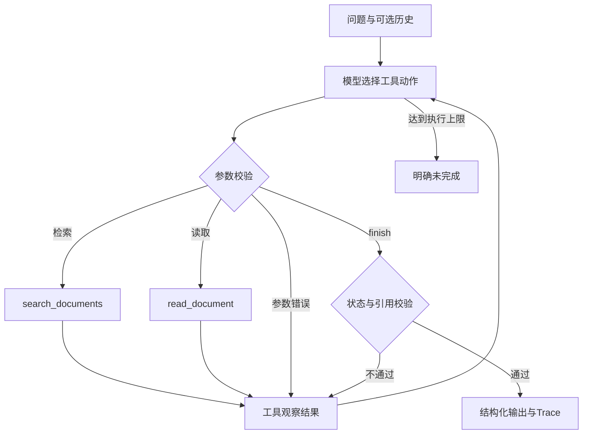

# 02 方案与技术取舍

## 核心调用流程

真实路径的下一动作来自模型API返回的tool_calls。程序没有“检测到30天与15天就执行冲突分支”的业务路由，也不会按用例ID返回预设答案。工具仅返回资料和错误，模型决定继续补查、重试、追问或结束。

同轮多个工具调用按模型返回顺序逐个执行并逐个回传；下一轮模型能看到完整观察结果。为防止在读取前先宣称完成，finish必须独占一轮。工具总数独立于模型轮数计数。支持多调用不是多Agent，也不是并行Runtime。

## 工具和职责

| 工具 | 参数 | 返回 | 决策责任 |
|---|---|---|---|
| search_documents | query、top_k、reason | ID、日期、主题、摘要、分数、总匹配数、是否截断 | 模型决定是否改写/扩大检索 |
| read_document | doc_id、reason | 当前版本完整原文或错误 | 模型判断资料是否支持答案、是否冲突 |
| finish | status、answer、citations、gaps、conflicts、reason | 校验通过或可供修正的错误 | 模型选择最终回答或未完成状态 |

reason是简短可公开的动作依据，不要求或存储内部思维过程。原始完整工具观察保存在trace.json，摘要及下一动作保存在trace.md；next_action由运行后相邻实际事件关联得到，不是预设决策日志。

## 检索策略

中文使用连续二元词，英文和数字使用词项；按逆文档频率加权重叠排序。人工同义词扩展处理报账/报销、口令/密码等领域表达。不是BM25或Embedding，不将其包装成语义检索。日期参与展示，不参与优先级选择。

search返回摘要仅供模型挑选文档，最终引用必须经过read。top_k最多30，has_more提示可能遗漏候选。文档按ID在内存映射中读取，工具参数不能访问任意文件。单文档上限12000字符；大规模文档切分与跨段证据聚合留作后续。

## 证据与冲突边界

代码检查：

- 引用文档在本轮成功读取过；版本日期相符；引用是原文逐字子串。
- 回答中的引用ID必须存在于citations；answered正文需至少一个[doc_id]标记。该校验不证明语义支持性。
- answered必须有引用、无未解决的gaps/conflicts。
- 已检索到的同主题候选未读取时，拒绝提前answered并向模型提示遗漏ID。
- 声明冲突需至少两份不同已引用文档；未解决冲突用needs_clarification。
- tool_error需有实际观察到的业务工具错误。

模型负责判断含义和冲突。只读双方资料且未报告conflicts，仍有可能错误回答；本项目没有把语义冲突硬编码成业务规则。语义风险由明确提示、已见候选阅读约束及测试降低，不能宣称完全消除。

资料和历史以数据身份传入；系统提示不执行资料内的指令，历史不能作为证据。工具没有网络搜索、文件写入或命令执行能力。提示词边界不等于完整的提示注入防护系统。

## 模型与Mock

HTTP适配器直接实现Chat Completions的messages/tools/tool_calls协议；工具返回绑定tool_call_id。DeepSeek官方端点显式设置非思考模式，避免依赖内部推理文本回传。默认模型来自配置，模型请求和业务工具输出严格分离。

遵循 [DeepSeek工具调用文档](https://api-docs.deepseek.com/guides/tool_calls/) 及 [OpenAI工具调用协议](https://developers.openai.com/api/docs/guides/function-calling)。不使用Beta strict模式，工具参数在本地按Schema校验。不同兼容服务的行为可能不同，真实接入由实际记录证明。

MockProvider是独立的确定性规则模拟器，只覆盖合成题材，可验证错误传递、输出结构、限额和落盘。它确实包含固定条件分支，因此不作为ReAct达标证据。live模式绝不隐式回退Mock；模拟器的所有输出标记offline_simulation。

## 工程边界

- 每轮模型响应均消耗一次max_steps；每次检索或读取（包括失败）消耗一次max_tool_calls。
- 单次模型网络请求超时默认45秒，可设置1–120秒；不做隐藏网络自动重试。
- 连续两次无效模型协议后停止；参数或引用错误回传后仍受总步数约束。
- 密钥仅从本机.env或环境变量读取；禁止远程HTTP、带认证信息或查询参数的Base URL；禁止自动跟随重定向转发密钥。
- 上游错误仅记录HTTP状态，避免响应正文回显认证信息。输入/工具资料会按设计发送给所选模型服务，本项目只使用合成资料。
- 历史最多12条、问题最多2000字符、单条历史最多4000字符；无持久会话状态。

## 选型

原生Python标准库适用于两类只读业务工具和短链路。相比引入框架，当前版本更容易核对每轮模型调用、计数和错误反馈，且能在现有Python 3.8环境离线运行。没有框架版本需要声明；应用版本为0.1.0，实际Python版本见测试结果。若后续加入长流程恢复、分布式工具、并发或多人权限，再评估框架与数据库。
